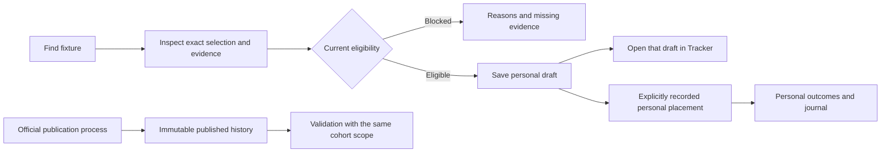

# Qwantej GUI, UX, information flow and maintainability audit

Date: 25 October 2026 (Africa/Blantyre). Status: audit and proposed implementation plan, not a completed redesign.

## Scope and evidence

Reviewed the current React shell, page composition, loading and navigation logic, candidate and performance endpoints, market qualification structure, CSS, imports, repository status, production build and existing frontend tests. Inspected the signed-in admin app at http://127.0.0.1:8001 through Today, Acca Analysis, Matches, Live, Stats & trends, Research / Market ROI, Track / Paper ledger, Validate / Performance, Tools and Admin. Sampled the mobile shell at 390 × 844. Source inspection covered additional panels and drilldowns.

This is a broad product/architecture audit, not proof that every control, data record or backend policy is correct. Free/Pro permission journeys, public registration/payment, all secondary tabs, comprehensive keyboard/screen-reader testing, all mobile pages, database query plans and representative cold/warm authenticated latency benchmarks remain unverified. No records, qualification rules, accounts or running services were changed. Existing untracked frozen-score-cohort work was left intact.

The deployed entry JS and CSS asset names match the fresh local build. Readiness returned HTTP 200. A single local HTML request took approximately 176 ms; that is NOT a page-load or API performance benchmark.

## Assessment

The main problem is overlapping responsibilities and inconsistent population/context, rather than literal copied files. The app has valuable evidence protections and useful features, but users must understand several hidden scopes before they can interpret a screen. Simplification should remove unnecessary decisions and requests while preserving provenance, publication history and market-specific gates.

Keep: separate Football/Research workspaces; immutable paper evidence; personal journal separation; market-specific fail-closed qualification; selection-level detail; explicit unavailable states; progressively disclosed ticket legs; whole-word completed-match search; route-level lazy loading; server gzip compression.

## Findings, ordered by priority

### P1 — A live navigation failure needs diagnosis before cosmetic work

Observed: after viewing Today / Acca Analysis, opening Matches and then Live, the entire workspace displayed “The workspace needs to reload.” Reload restored Live. A later transition away from a still-loading Matches page did not fail. Treat this as an observed intermittent failure, not a proven deterministic reproduction.

The captured logs did not establish the component stack or cause. Do not attribute it to the table sorter without a reproduction. Add a navigation regression journey and capture the existing error boundary's diagnostic with the failing sequence. Prefer route-level recovery so one failed panel does not remove the entire navigation shell.

Evidence: `frontend/src/main.tsx` error boundary; live session.

### P1 — Unrelated requests block Today, Matches and Research

`DailyTicketsPage.load` waits for tickets, fixtures, qualified selections, rejected selections, optional custom accumulators and market ROI together. For admin, Today starts five requests even though its default view primarily needs published tickets; Matches starts six. Research also loads ticket and fixture data unrelated to its default report. Child panels can add more requests.

The five-minute refresh sets the same global `loading` flag used for first load. The conditional replaces the entire content subtree with a skeleton: open dialogs and child state can disappear, and remounts can repeat child requests. Fixture errors become an empty array, which can look like “no fixtures” rather than a failure. There is no abort/in-flight guard for this shared loader. `initialTab` is read in the callback but omitted from its dependencies; current route keys mitigate changes by remounting, rather than making the loader independently correct.

Action: give each route/tab an explicit data dependency; separate initial loading from background refresh; retain last successful data with an error/stale label; cancel obsolete requests; pause polling when hidden; deduplicate requests by role, date and scope. Preserve admin Matches' ROI gate until it becomes an explicit named research preset—do not silently remove it as a speed optimization.

Evidence: `frontend/src/pages/dailyTickets/DailyTicketsPage.tsx:80`, `:125`, `:345`; `App.tsx` keyed page mounts.

### P1 — The Matches population is narrower than its language promises

The live admin view said it showed every available match meeting Q ≥70 and the market ROI formula, but then displayed a Q ≥75 candidate view with four matches. Research's daily report showed 15 matches / 16 picks for that date. These are different filtered populations, not evidence of lost records.

`GET /selections/qualified` defaults to a Q threshold and caps output at 100 selections before the client intersects it with the ROI candidates and applies its own filters. “Showing 100 of 100” in Acca Analysis refers to the received subset, not the complete database population. Lowering a client filter cannot recover rows already excluded upstream. Admin Matches applies an ROI intersection; Pro Matches does not; Free Matches uses FixtureExplorer. The same navigation label therefore refers to three different experiences.

Action: offer an explicit view selector: All fixtures / Model candidates / ROI research preset. Return `total`, pagination and applied scope from the API, or clearly label a ranked top-100 sample. Use one authoritative filter definition per view. Name Q70 and Q75 presets separately if both are intentional.

Evidence: `backend/app/api/v1/selections.py:302` through the `.limit(100)` query; `DailyTicketsPage.tsx` `roiGatedMatches`; `AllMatches.tsx:69` onward.

### P1 — Model rating and present eligibility are visually conflated

Acca Analysis showed stored “BET” ratings next to “No valid price” and “Edge unavailable,” while all three ticket bands correctly said no eligible ticket. It also displayed finished and upcoming selections together. The explanatory paragraph acknowledges that the original rating stays unchanged, but the row's strongest signal is still BET.

Action: separate `Stored model rating` from `Current eligibility`, e.g. “Model: BET / Unavailable: no fresh quote.” Default the builder to upcoming eligible selections; keep historical/blocked rows available through a deliberate filter. Preserve the original snapshot and rejection reasons. Move the lengthy bookmaker-selection methodology into a disclosure next to a concise price-source label. Consolidate repeated empty-ticket explanations into one shared explanation with counts.

Evidence: live Acca Analysis; `AccumulatorAnalysis.tsx:118` price overlay and subsequent eligibility filter.

### P1 — A successful add leads to the wrong Tracker view

Matches saves an accumulator and calls `onOpenTracker`, but App only navigates to `/tracker`. Tracker always initializes to `paper`. The user is taken away from the newly saved draft, which is under My accumulators. Likewise, My accumulators' `onOpenPicks` goes to Research's Market ROI landing rather than directly to a selectable candidate list. Research receives no tracker navigation callback.

Action: route to `/tracker?view=accumulators&ticket=<id>` after saving and focus the saved ticket. Route “Choose picks” to an explicit candidate view while preserving draft/date. Provide a visible success state and retryable failure state.

Evidence: `DailyTicketsPage.tsx` `addToAccumulator`; `App.tsx` Tracker callbacks; `Tracker.tsx` initial `view` and `onOpenPicks`.

### P1 — Reporting scopes can produce apparently conflicting totals

Observed: Paper ledger default showed 70 latest cohorts, 67 settled and +MK 6.02; Validate showed 73 tickets, 70 settled and +MK 3.02. Paper ledger defaults to current model; Validate's empty model filter means all models, despite an evidence banner displaying the current model version. These numbers must not be compared as identical populations.

There is also a code-level ordering difference: PaperLedger chooses latest cohort versions first, then filters by model; `performance_summary` filters model first, then chooses latest versions. When a cohort has versions across model changes, these definitions can select different records even with the same model filter.

Action: define one shared report scope contract: model, dates/timezone, tier, latest-version policy, settled population, pricing era and stake basis. Align defaults and pass scope in links between Track and Validate. Keep historical versions accessible. A visible “All models” badge must not be replaced by a current-model metadata label. Reconcile totals using record IDs before changing any accounting.

Evidence: `PaperLedger.tsx:77`, `:95`, `:125`; `Analytics.tsx` performance request/default filters; `backend/app/services/performance.py:89` onward.

### P1 — The current frontend regression baseline is failing

`npm run build` passed. `npm test` produced 42 passed / 7 failed tests across 11 files (9 passing files, 2 failing files). Six failures are in `TicketCard.test.tsx`, covering publication metadata, rolling horizons, fair/model-priced text, rejection reasons and compact expansion. One is in `CustomAccumulatorPanel.test.tsx`, expecting the combined horizon label. Some assertions may be stale after intentional presentation changes; this audit does not classify every failure as a product regression.

Action: establish the intended visible behavior, then fix code or assertions accordingly. Do not simply update snapshots to silence the suite. Test actual visible expansion/detail behavior, saved-draft navigation, filters and refresh preservation.

### P2 — Several independent systems own table sorting

`table-sorters.ts` observes the entire document subtree, scans all tables on child mutations, injects header buttons, and physically reorders rows. React-owned `SortableTable` also exists. The global enhancer avoids headers with buttons/aria-sort, so this is not proof that every table is double-sorted. It is still two ownership models, with risk of DOM reconciliation conflicts and repeated scans. Mixed-content cells may sort by formatted text rather than the intended numeric field.

Action: migrate table by table to explicit React sort state and typed sort accessors. Retain functionality and accessibility before removing the global observer. Include sorting followed by refresh/navigation in regression tests. Its contribution to the observed crash is unproven.

Evidence: `frontend/src/table-sorters.ts`, `main.tsx:9`, `components/SortableTable.tsx`.

### P2 — Matches exposes too many controls before the records

Live Matches included an intro, ROI policy paragraph, featured candidate, overview sidebar, league shortcuts, search, league dropdown, quick-market buttons, status buttons, seven sort controls, saved-filter management and seven advanced numeric filters before its match cards. The featured candidate was a finished losing selection while upcoming matches were available. This may be correct historical evidence, but it is a distracting default for finding today's upcoming candidates.

Action: show search, date, status and competition first; move numeric constraints and saved-filter management under “More filters”; use one sort menu; group upcoming/in-play/finished explicitly. Remove the mandatory featured candidate or let it follow the active status/filter scope. Show a compact active-filter summary and result count.

Evidence: live Matches; `AllMatches.tsx`; `DailyTicketsPage.tsx` `DecisionSummary`.

### P2 — Navigation loses task context

Research, Tracker and Analytics subviews live only in local state. Research visits force a remount. Match Intelligence always returns to Today, regardless of whether the user arrived from Matches or Research. Login redirect does not preserve the requested destination. `navigate` builds a new query string rather than retaining the originating page's filters. The selected prediction ID is now passed into Match Intelligence—retain this improvement.

Live notification clicks link to `/match/<id>`, which App classifies as admin-only, although Live is visible in the Football workspace. Non-admin notification recipients can be redirected to Today rather than the referenced match.

Action: serialize meaningful view state in URLs; retain origin, filters and scroll position for drilldown/back; preserve authorized login return destinations; ensure notification destinations respect the user's access. Do not weaken backend permissions to fix navigation.

Evidence: `App.tsx` `navigate`, `navigateToMatch`, `isInternalPage`; `LiveMonitor.tsx` `notification.onclick`; local tab state in page components.

### P2 — Accessibility patterns are inconsistent

SelectionDetail implements Escape, focus trapping and focus restoration. RejectionReasons handles Escape/restoration but has no equivalent trap; Acca Analysis focuses its dialog and handles Escape without equivalent trap/restoration. Tools shows visually adjacent labels with unnamed spinbuttons in the accessibility tree because several labels are not associated with inputs. Analytics/Tracker tablists need a consistent keyboard pattern and tab-panel associations. Primary navigation uses buttons rather than links, limiting standard open-in-new-tab behavior.

Action: share a tested dialog primitive; associate every input label; implement one accessible tab/navigation pattern and focus the main heading after route changes. Test keyboard flow across nested evidence views. Mobile shell sampled successfully, but its account controls/date selector consume three header rows; consolidate account/theme controls into a menu and retain the date row.

### P2 — Data fetching and reporting have avoidable cost

`daily_market_roi` loads the matching history as full Prediction objects, joins Match, and evaluates/deduplicates in Python on each request. Its endpoint directly calls the service; no report-result cache appears in that path. The shared daily loader calls this even on Today. `performance_summary` loads tickets and related selections/results before applying date/model filters in Python. PaperLedger requests the entire performance summary just to obtain `current_model_version`.

Action: first stop unnecessary calls. Then measure query count/time, selected row count and payload size. Push appropriate bounds/projections into SQL, use deterministic version selection, and cache report results with explicit invalidation for prediction/publication/settlement changes and visible as-of metadata. Never serve a stale cached qualification as current eligibility. Add a lightweight metadata endpoint or reuse existing configuration metadata for current model version.

Other source findings: Analytics refetches the pipeline status with each model-text keystroke and has no obsolete-response guard in its main effect; Insights makes an initial default request then another when it sets competition/season. Fix races before optimizing request count. Live polls all today's fixtures and filters live rows client-side. Add a dedicated live query only if measured payload justifies it.

### P2 — CSS and page modules have accumulated maintenance cost

App.css has 4,518 lines; DailyTicketsPage 709; AllMatches 688; lib/api 906; Analytics 614 lines with many large JSX expressions. App.css repeats `.main` nine times and `.app-header` six times in the selector scan; some repetition is intentional responsive styling, so this is not a deletion list.

Fresh build: shared entry CSS 214.13 kB / 33.72 kB gzip; entry JS 182.40 / 59.08 kB; DailyTickets JS 125.61 / 33.87 kB. These are individual asset sizes, not complete route transfer totals. Route lazy loading already exists. DailyTickets statically imports several unrelated panels, limiting that separation. Gzip already exists in FastAPI; recommending “enable gzip” would duplicate current work.

Action: split CSS by actual ownership (shell, tokens, primitives, route); consolidate competing overrides with visual comparisons; split Today/Matches/Research composition and lazy-load heavy tab bodies and evidence panels. Extract API transport/types from formatting/domain helpers. Do not introduce a new framework merely to reorganize files.

### P3 — Dead-code candidates exist, but similarly named files are not automatically duplicates

Scanned 178 TS/TSX/CSS/Python source files in frontend/src and backend/app. No exact byte-identical source files over 100 bytes were found. This does not rule out copied functions, semantic duplication, scripts/assets elsewhere or database duplicates.

| Candidate | Evidence / disposition |
|---|---|
| `components/DateNav.tsx`, `LegRow.tsx`, `RunModelModal.tsx` | No references found in frontend source search; absent from approximate main.tsx import graph. Strong removal candidates after final repository-wide consumer check. |
| `pages/dailyTickets/SelectionPanel.tsx` | Exported by compatibility barrel and referenced by tests; no live rendering found. Move useful tests to active surfaces before retiring. |
| `frontend/src/api.ts` | One-line re-export, not a second API implementation. Standardize imports before removal. |
| `frontend/src/types.ts` | Compatibility exports plus legacy prediction types; absent from approximate runtime graph. Check tooling/test consumers before removal. |
| `pages/DailyTickets.tsx` | Intentional compatibility barrel, not duplicate page logic. Can disappear when imports are migrated. |
| `assets/archive/*`, root sortable HTML reports | No archive-asset source references found; review as historical artifacts, not performance bottlenecks unless served/imported. Do not silently delete research outputs. |
| `Under*Qualification`, `Over*Qualification`, backend market policies | Similar layouts and helpers, but materially different rules and evidence. Share presentation and safe primitives; retain versioned market-specific thresholds, tests and exceptions. |
| `performance`, `performance_export`, `singles_*`, ticket/personal ledgers | Similar names can represent different responsibilities/populations. Preserve contracts; do not merge financial/evidence populations for visual simplicity. |

There is also commented-out legacy JSX in DailyTicketsPage. Remove after confirming it contains no still-needed rationale; Git preserves history.

## Proposed information architecture

Retain two workspaces but give each destination one responsibility:

| Destination | Primary job | Default content | Secondary content |
|---|---|---|---|
| Football → Today | Review published recommendations | Compact publication status + published selections | Expandable ticket tiers, evidence, stake scenario |
| Football → Matches | Find a fixture or candidate | Search/date/status/league + list | Explicit candidate/ROI presets and advanced filters |
| Football → Live | Follow matches in play | Live and favourite matches | Freshness/source details and optional alerts |
| Football → Stats | Inspect historical match context | Completed-match search and league summary | Team tables and trends |
| Research → Candidates | Inspect model/market candidates | Named preset, scope, eligible/blocked counts | Rejection reasons, Market ROI, policy experiments |
| Research → Tracker | Inspect saved records | Explicit Paper history / Personal records switch | Published match history, draft/placed accumulators, journal |
| Research → Validation | Evaluate a defined cohort | Scope + a few headline metrics | Calibration, recommendation ledger, backtests, experiments |
| Research → Utilities | Run an illustrative calculation | Calculator selector | Methodology and assumptions |
| Research → System | Diagnose operations | Current health + actionable alerts | Pipeline history, users, cache and recovery actions |

Make Acca Analysis one canonical destination within Candidates, with shortcuts from Today and Matches that preserve date/filter context. Reusing the component is good; maintaining three independently resetting task contexts is not. Keep personal drafts distinct from its unsaved suggestions and official published tickets.

Suggested Today structure:

```text
Date                              Publication status / checked at
Published selections (count)      [Open match search]
Fixture | pick | price snapshot | match/selection status | Evidence

Published ticket tiers            [Expand a tier]
  Combined odds • estimate • result • saved version
  Legs and provenance revealed on demand

Optional: stake scenario           [collapsed]
```

Suggested end-to-end flow:



This is navigation/information flow, not permission to place bets or change publication rules. Model rating, eligibility, publication, placement and settlement are separate states. Every headline number should identify its population, date range/model, data timestamp and calculation basis. Prefer details on demand over repeating these explanations in every row.

## Implementation sequence and acceptance criteria

1. **Stabilize and make scope truthful.** Diagnose the render failure; reconcile the seven failing tests; distinguish stored rating/current eligibility; disclose truncated candidate populations; fix saved-draft destination and origin-aware back navigation. Acceptance: complete Today → Matches → evidence → back → draft → Tracker without crashes or lost selection/date; reported counts explicitly match API scope.
2. **Separate route data and refresh behavior.** Split shared loader ownership; preserve content during background refresh; cancel obsolete responses; link tabs in URLs. Acceptance: default Today does not request candidate/rejection/ROI datasets until needed; a failing optional report cannot blank published tickets; filters/dialogs survive routine refresh; repeated navigation reuses valid scoped data.
3. **Simplify GUI progressively.** Reduce Matches' visible controls; establish one Acca Analysis destination; consolidate account controls; share accessible dialogs/tabs; separate operational status from administration forms. Acceptance: core tasks work on desktop and 390px viewport, keyboard only, with clear empty/error/stale states and no hidden essential actions.
4. **Consolidate code and style.** Remove verified unused components/legacy comments; migrate DOM sorting; split route CSS and heavy panels; share qualification presentation without changing policy behavior. Acceptance: frontend suite/build pass; sorting stays correct after refresh; no qualification or snapshot behavior changes; before/after visual comparisons cover all major routes and roles.
5. **Optimize measured backend cost.** Profile report endpoints, project only needed columns, bound queries, paginate and safely cache aggregates. Acceptance: equal scoped results before/after; invalidation tests for publication/settlement; documented cold/warm p50/p95 latency, request counts and payload sizes.

Suggested performance targets (targets, not measured current results): no full-page skeleton during background refresh; cached route revisit usable within 300 ms on the agreed local test setup; initial key content within 2 s under a defined desktop/mobile network profile; no increase in qualification errors or stale-evidence acceptance. Record baseline before setting hard latency budgets. Do not trade away provenance for speed.

## Verification and boundaries

- Production build: passed; 83 transformed modules.
- Existing frontend tests: 42 passed, 7 failed; failures recorded above.
- Live local readiness: HTTP 200; entry assets match local build.
- No backend tests or database mutations performed; no implementation speedup claimed.
- Previous audit issues about selected-market context, global fake refresh time and Admin quote-scope wording have visible/source improvements. Do not reopen them as unchanged defects. Remaining issues concern return context, cross-report scope and current eligibility.
- Audit-created change: this report only. Build output was generated locally; application source and runtime behavior were not changed.

## Follow-up implementation status — 25 October 2026

The implementation and verification details are recorded in [`GUI_UX_INFORMATION_FLOW_IMPLEMENTATION_2026-10-25.md`](GUI_UX_INFORMATION_FLOW_IMPLEMENTATION_2026-10-25.md). The later follow-up pass completed authenticated read-only coverage of Today, Matches, evidence, Tracker, validation, Tools and Admin; sampled the responsive shell at 390 px and 1280 px; and added keyboard/accessibility semantics to key tabs and dialogs.

Performance profiling identified the daily market ROI report as the main service-side cost. Narrow ORM projections reduced its measured median from 2,077 ms to 705 ms on the local database while preserving 686 historical unique selections, 16 candidates and 4 qualifying markets. Three authenticated Matches reloads reached the 100-of-188 candidate count in 1.84–2.10 s (median 2.05 s); the sample used warm browser assets and is too small for a p95 or load-time target.

The saved-draft journey remains unverified because the signed-in tracker contains only placed or settled records; no persistent test draft was created. A full screen-reader certification and cold/warm browser p50/p95 profile also remain open. No publication, result, or personal ledger record was changed during the follow-up.

## Final follow-up status — 25 October 2026

The implementation report records the completed disposable-database draft journey, async ORM response fix, broader keyboard/accessibility-tree review, and authenticated browser reload sample. The disposable clone was removed and the live database remained unchanged. Browser timings were warm reloads only: Today median 1.66 s (8 runs), Matches 5.04 s (8), Tracker 1.36 s (4), Validate 1.50 s (8). Matches is the end-to-end outlier; sample sizes are too small for a meaningful p95 or hard target, and true cache-cleared cold-start profiling remains open.

The accessibility review exercised browser accessibility-tree semantics and keyboard interaction across the remaining routes and tabs. It does not certify screen-reader speech output; a manual NVDA or JAWS pass remains open. The Tracker's long settled history is a potential navigation burden and should be considered for collapsed-by-default archive periods.

The saved-draft journey is verified. No publication, result, live personal ledger record, or frozen-score-cohort evidence was changed.

## Additional follow-up — 25 October 2026

The authenticated Matches accessibility tree was checked again: navigation, date, candidate count, filters, sort, result summary, match-card disclosure state, and pagination action expose readable names and states. This remains an AX-tree spot review; speech output was not certified. Narrator could not be observed through the Windows UI controller, and the temporary NVDA launch timed out. No NVDA or JAWS speech review was completed.

Source review shows that qualified candidates and personal accumulators load together, while the daily market-ROI report loads concurrently and gates the admin candidate list. This makes the ROI response a likely display dependency, but no browser request waterfall was captured. The reload probe was discarded because the existing page marker was already present; no valid cold-start measurement was made, and the Chrome profile cache was left intact. The 5.04 s warm Matches median remains the only browser signal; it is not a cold-start baseline or a target.

The suggestion to group older settled accumulators under an accessible, collapsed-by-default disclosure remains unimplemented pending a speech and focus review. The audit is not fully closed: manual NVDA/JAWS speech review, cache-cleared cold-start profiling, and the Matches request waterfall remain open.
